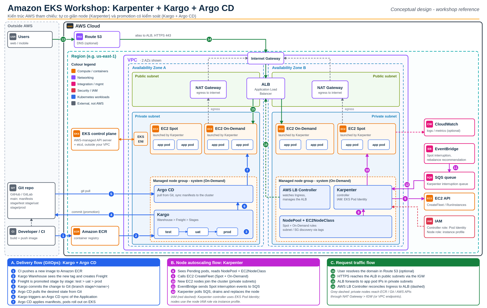

# Karpenter-Kro-Argo-EKS

Workshop giới thiệu các công cụ mã nguồn mở hay dùng trên Amazon EKS: **Karpenter** (tự co giãn node), **Argo CD** (GitOps) và **Kargo** (promotion giữa các môi trường). Kro và ACK nằm trong kế hoạch mở rộng của repo này.



> Đây là thiết kế tham chiếu (conceptual design). Các bước lab chưa được chạy thật trên AWS, nội dung bám theo tài liệu chính thức.

## Mục lục

- [Giới thiệu](#giới-thiệu)
- [Vai trò của từng công cụ](#vai-trò-của-từng-công-cụ)
- [Nội dung slide](#nội-dung-slide)
- [Kiến trúc](#kiến-trúc)
- [Cấu trúc thư mục](#cấu-trúc-thư-mục)
- [Xem và build slide](#xem-và-build-slide)
- [Tình trạng hiện tại](#tình-trạng-hiện-tại)
- [Lộ trình](#lộ-trình)
- [Tài liệu tham khảo](#tài-liệu-tham-khảo)

## Giới thiệu

Khi chạy workload thật trên EKS, thường gặp hai câu hỏi:

- **Node:** làm sao để cluster tự thêm node khi thiếu chỗ và bỏ node khi dư, mà vẫn tiết kiệm chi phí (Spot, On-Demand)?
- **Release:** làm sao để đưa một phiên bản mới từ dev lên staging rồi prod một cách an toàn, có kiểm soát, không sửa tay manifest?

Repo này gom slide, sơ đồ và (về sau) mã lab để trả lời hai câu hỏi trên bằng các công cụ mã nguồn mở. Đối tượng là DevOps/Cloud engineer đã biết Kubernetes cơ bản.

## Vai trò của từng công cụ

| Công cụ | Vai trò | Quản lý |
|---|---|---|
| **Karpenter** | Thấy pod `Pending` thì tạo node EC2 vừa đủ (Spot hoặc On-Demand), dư thì gom lại và xoá node | Hạ tầng tính toán (node) |
| **Argo CD** | Đọc Git, so với trạng thái trong cluster và sync cho khớp (GitOps) | Việc deploy: cái gì chạy trong cluster |
| **Kargo** | Chuyển (promote) một bản phát hành qua các môi trường dev, staging, prod, ghi lại vào Git | Luồng promotion giữa các Stage |
| **kro** *(kế hoạch)* | Gom nhiều resource thành một API riêng bằng `ResourceGraphDefinition` | Cách đóng gói và ghép resource |
| **ACK** *(kế hoạch)* | Tạo resource AWS (DynamoDB, S3, SQS...) từ CRD trong Kubernetes | Resource AWS bên ngoài cluster |

## Nội dung slide

Bộ slide gồm 12 slide (tiếng Việt, có speaker notes):

1. Tiêu đề và mục tiêu workshop
2. Vì sao EKS cần thêm công cụ
3. Karpenter là gì và cách hoạt động
4. Khái niệm chính: `NodePool` và `EC2NodeClass`, kèm YAML
5. Chạy thật: checklist và so sánh với EKS Auto Mode
6. Argo CD: nền cho Kargo
7. Kargo là gì
8. Khái niệm Kargo: Warehouse, Freight, Stage, Promotion
9. Ví dụ YAML Kargo: Warehouse và Stage
10. Ghép lại: kiến trúc tổng thể trên EKS
11. Lab thực hành (khoảng 2 giờ, là ước lượng)
12. Tổng kết và tài liệu tham khảo

## Kiến trúc

Sơ đồ mô tả ba luồng:

- **Delivery (GitOps):** CI đẩy image lên Amazon ECR, Kargo tạo Freight và promote qua các Stage, commit vào Git, Argo CD sync vào EKS.
- **Node autoscaling:** Karpenter thấy pod `Pending`, gọi EC2 `CreateFleet`, node mới join cluster. EventBridge và SQS báo Spot interruption về Karpenter.
- **Request traffic:** Route 53 (tuỳ chọn), ALB ở public subnet, pod ở private subnet. AWS Load Balancer Controller quản lý ALB.

Giả định trong sơ đồ: 2 AZ, region ví dụ `us-east-1`, Karpenter dùng EKS Pod Identity.

## Cấu trúc thư mục

```
Karpenter-Kro-Argo-EKS/
├── README.md
├── slides.md        # nguồn slide (Marp)
├── slides.pdf       # bản xuất PDF
├── slides.pptx      # bản xuất PowerPoint
├── slides.html      # bản xuất HTML
├── .marprc.yml      # cấu hình marp-cli
└── images/          # sơ đồ dùng trong slide và README
```

## Xem và build slide

Yêu cầu: Node.js để chạy `npx`. Xuất PDF hoặc PPTX cần cài thêm Chrome hoặc Chromium.

```bash
# Xuất HTML
npx --yes @marp-team/marp-cli slides.md -o slides.html

# Xuất PDF
npx --yes @marp-team/marp-cli slides.md --pdf -o slides.pdf

# Xuất PowerPoint
npx --yes @marp-team/marp-cli slides.md --pptx -o slides.pptx
```

Nếu Marp không tìm thấy Chrome, đặt biến môi trường `CHROME_PATH` trỏ tới file thực thi của trình duyệt.

## Tình trạng hiện tại

- Slide và sơ đồ đã xong, đã được review và render thử.
- Phiên bản tham chiếu (tra ngày 15/10/2026): Karpenter v1.15.0, Kargo v1.12.4, Argo CD v3.5.5.
- Slide chưa có phần kro và ACK, sơ đồ cũng chưa vẽ hai công cụ này.
- Các bước lab chưa chạy thật trên AWS.
- Còn hai điểm cần xác nhận: mức phiên bản Argo CD tối thiểu mà Kargo hỗ trợ, và việc Kargo có chạy với Argo CD dạng managed của EKS hay không.

## Lộ trình

- [x] Slide giới thiệu Karpenter, Argo CD, Kargo
- [x] Sơ đồ kiến trúc AWS
- [ ] Bổ sung kro và ACK vào slide và sơ đồ
- [ ] Terraform dựng VPC, EKS và IAM nền
- [ ] GitOps: Argo CD app-of-apps, `NodePool`, `ResourceGraphDefinition`
- [ ] Lab chạy thật và đo chi phí
- [ ] Bài viết và video demo

## Tài liệu tham khảo

- [Karpenter](https://karpenter.sh/docs/)
- [Kargo](https://docs.kargo.io/)
- [Argo CD](https://argo-cd.readthedocs.io/)
- [kro trên Amazon EKS](https://docs.aws.amazon.com/eks/latest/userguide/kro.html)
- [Amazon EKS User Guide](https://docs.aws.amazon.com/eks/latest/userguide/)
- [Marp](https://marp.app/)
