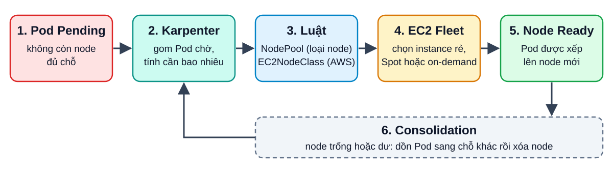
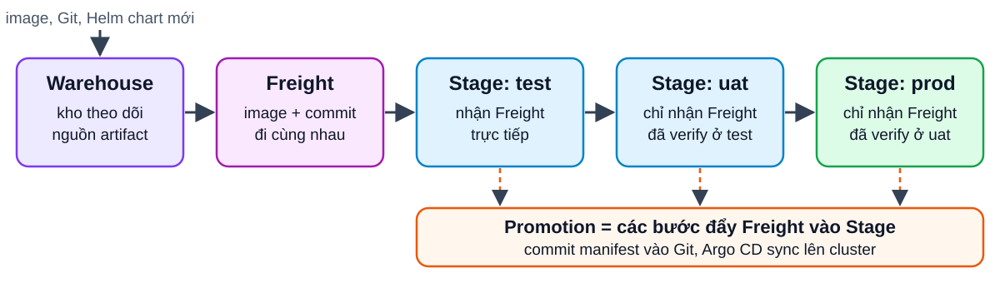
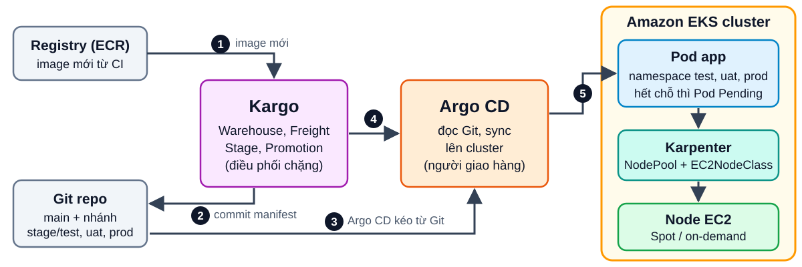

<!-- _class: lead -->
<!-- _paginate: false -->

# Workshop EKS: Karpenter + Kargo

**Node tự co giãn. Release có kiểm soát.**

- Hiểu Karpenter làm gì và khi nào dùng (so với EKS Auto Mode)
- Hiểu Kargo + Argo CD đưa một bản build qua test, uat, prod
- Biết cách tự dựng lab và kiểm tra bằng `kubectl`

<span class="small">Dành cho DevOps/Cloud engineer đã biết Kubernetes cơ bản · Cập nhật 15/10/2026</span>

<!--
Thời lượng: 2 phút.
Chào và nói thẳng mục tiêu: hôm nay chỉ 2 công cụ chính (Karpenter, Kargo) và 1 công cụ làm nền (Argo CD).
Lưu ý: nhiều người gõ "carpenter", tên đúng là Karpenter (thợ mộc là carpenter, còn Karpenter là autoscaler).
Hỏi nhanh khán giả: ai đang dùng Cluster Autoscaler? ai đang sửa tay manifest khi lên prod?
-->

---

# Vì sao EKS cần thêm công cụ?

<div class="cols">
<div class="card a">

## Node: scale sao cho gọn?
- Pod `Pending` vì hết chỗ trên node
- Cluster Autoscaler làm việc qua **node group**, bạn tự quản lý từng nhóm
- AWS mô tả: mỗi node group một loại instance

</div>
<div class="card b">

## Release: lên prod sao cho an toàn?
- Có image mới, ai đó sửa tay manifest từng môi trường
- Dễ lệch nhau giữa test, uat, prod
- Khó trả lời: "prod đang chạy bản nào?"

</div>
</div>

<p style="margin-top:18px"><strong>Karpenter</strong> lo node. <strong>Kargo</strong> lo promotion. <strong>Argo CD</strong> lo deploy.</p>

<!--
Thời lượng: 3 phút.
Kể chuyện: 2 giờ sáng pod Pending vì node group đầy, hoặc sáng thứ Hai không ai nhớ prod đang chạy tag nào.
Nguồn câu về node group: EKS Best Practices (Auto Mode FAQ) so sánh Cluster Autoscaler với Karpenter.
Không đưa số liệu tốc độ hay tiết kiệm chi phí, vì không có benchmark xác nhận trong buổi này.
-->

---

# Karpenter là gì?



Như gọi taxi theo nhu cầu, thay vì thuê sẵn một đội xe. Dự án của `kubernetes-sigs`, bản **v1.15.0** (10/10/2026), API **v1** ổn định.

<!--
Thời lượng: 4 phút. Đi theo số 1 đến 6 trên sơ đồ.
Ý chính: Karpenter nhìn Pod Pending, gom lại, bin-pack, rồi gọi EC2 Fleet chọn instance (FAQ: truyền 60 lựa chọn cho Fleet, Fleet dùng price-capacity-optimized).
Nhấn: Karpenter không cần node group. Nó chạy được cạnh Managed Node Group và cạnh Cluster Autoscaler (FAQ).
Maturity: Karpenter là dự án của Kubernetes SIG (kubernetes-sigs), không phải dự án CNCF có cấp maturity. Có mặt trong CNCF landscape nhưng không có nhãn graduated/incubating.
Karpenter 1.0 ra bản stable API v1: NodePool và EC2NodeClass sẽ không có breaking change giữa các minor 1.x (AWS Containers Blog).
-->

---

# Khái niệm chính: NodePool + EC2NodeClass

<div class="cols">
<div>

```yaml
apiVersion: karpenter.sh/v1
kind: NodePool
metadata:
  name: default
spec:
  template:
    spec:
      requirements:
        - key: karpenter.sh/capacity-type
          operator: In
          values: ["spot", "on-demand"]
      nodeClassRef:
        group: karpenter.k8s.aws
        kind: EC2NodeClass
        name: default
      expireAfter: 720h
  limits:
    cpu: "100"
  disruption:
    consolidationPolicy: WhenEmptyOrUnderutilized
    consolidateAfter: 1m
```

</div>
<div>

```yaml
apiVersion: karpenter.k8s.aws/v1
kind: EC2NodeClass
metadata:
  name: default
spec:
  role: "KarpenterNodeRole-<cluster>"
  amiSelectorTerms:
    - alias: al2023@latest
  subnetSelectorTerms:
    - tags:
        karpenter.sh/discovery: "<cluster>"
  securityGroupSelectorTerms:
    - tags:
        karpenter.sh/discovery: "<cluster>"
```

<div class="small"><strong>NodePool</strong> = luật: loại node, giới hạn, khi nào dọn.<br><strong>EC2NodeClass</strong> = cấu hình phía AWS.<br>Spot ưu tiên trước, hết Spot rơi về on-demand.</div>

</div>
</div>

<!--
Thời lượng: 4 phút.
YAML bám theo trang Getting Started và trang NodePools của karpenter.sh (API karpenter.sh/v1, karpenter.k8s.aws/v1).
Giải thích: requirements là "danh sách món được phép", Karpenter tự chọn instance cụ thể. Nên cho nhiều loại instance để dễ có Spot.
Lưu ý: NodePool mẫu chỉ ràng buộc capacity-type nên Karpenter được chọn mọi họ instance. Bản prod cần thêm requirements như karpenter.k8s.aws/instance-category, karpenter.k8s.aws/instance-generation, kubernetes.io/arch (xem trang NodePools của karpenter.sh).
Thứ tự ưu tiên capacity type theo docs: reserved, rồi spot, rồi on-demand.
consolidationPolicy WhenEmptyOrUnderutilized + consolidateAfter 1m = dọn node trống/thừa sau 1 phút. expireAfter 720h = node sống tối đa 30 ngày rồi được thay.
alias al2023@latest tiện cho lab; với prod nên cân nhắc ghim phiên bản AMI. <cluster> là chỗ bạn thay tên cluster.
Thay đổi đáng nhớ khi từ beta lên v1: Provisioner/NodeTemplate đã thành NodePool/EC2NodeClass từ v1beta1, và v1 là API stable đầu tiên.
-->

---

# Chạy thật: checklist + so với EKS Auto Mode

<div class="cols">
<div>

- **IAM**: role cho controller, node role, SQS queue cho Spot interruption
- **Tag** `karpenter.sh/discovery` trên subnet và security group
- **Version skew**: EKS 1.37 cần Karpenter 1.15.x, EKS 1.36 cần ≥ 1.13, EKS 1.35 cần ≥ 1.9
- **Disruption budgets** + PDB để dọn node từ từ
- **limits** chặn chi phí vượt tầm

</div>
<div class="card c">

**EKS Auto Mode** (tra 15/10/2026)
- AWS chạy Karpenter **ngoài cluster**, bạn không thấy pod hay log
- NodePool vẫn là `karpenter.sh/v1`, NodeClass thuộc group `eks.amazonaws.com`
- Node sống tối đa 21 ngày, có phí quản lý theo instance
- Karpenter tự quản: linh hoạt hơn, bạn tự vận hành

</div>
</div>

<!--
Thời lượng: 4 phút.
Nguồn version: karpenter.sh/docs/upgrading/compatibility (ma trận hiện hành hiển thị EKS/K8s 1.31 đến 1.37). EKS đang standard support: 1.34 đến 1.37; extended: 1.31 đến 1.33 (docs.aws.amazon.com, kubernetes-versions).
Tag discovery và IAM bám theo Getting Started của Karpenter.
Auto Mode: docs EKS nói rõ nó là phần tự động hóa hạ tầng cluster, gồm compute autoscaling. FAQ trong Best Practices: khác biệt vận hành chính là bạn không phải tự deploy/scale/upgrade pod Karpenter. Cùng FAQ đó ghi AMI hiện chỉ có Bottlerocket do Amazon cung cấp (nếu cần AMI tùy biến, tự quản Karpenter). Phí quản lý Auto Mode cộng thêm vào giá EC2 (trang pricing).
Gợi ý chọn: muốn ít vận hành thì Auto Mode; cần kiểm soát AMI/phiên bản Karpenter thì tự quản. Không có đúng/sai tuyệt đối.
Workshop này dùng Karpenter tự quản để thấy rõ từng thành phần.
-->

---

# Argo CD: nền cho Kargo

- **GitOps**: Git là nguồn sự thật, Argo CD kéo và sync lên cluster
- Argo là dự án **CNCF graduated** (6/12/2022), bản mới nhất ổn định **v3.5.5**
- Kargo không deploy. Kargo cập nhật Git rồi nhờ Argo CD sync
- Application cần annotation `kargo.akuity.io/authorized-stage`
- <span class="small">[CẦN XÁC NHẬN: phiên bản Argo CD tối thiểu Kargo hỗ trợ; docs Kargo ghi đã test với v2.13.0]</span>

<span class="small">Argo CD = người giao hàng. Kargo = người quyết định thùng hàng nào được đi tiếp.</span>

<!--
Thời lượng: 2 phút. Đây là slide nền, không đào sâu.
Nguồn: cncf.io/projects/argo (accepted 26/3/2020, graduated 6/12/2022), github argoproj/argo-cd releases (v3.5.5 ngày 12/10/2026; v3.6.0-rc đang thử nghiệm).
Docs cài Kargo: "Kargo works best when paired with Argo CD", phần cài đặt cơ bản ghi test với Argo CD v2.13.0, nên ma trận tương thích chính thức cần xác nhận lại trước buổi workshop.
Ghi chú thêm: EKS có "EKS Capability for Argo CD" (Argo CD managed). [CẦN XÁC NHẬN: Kargo có chạy trơn với bản managed đó không]. Lab dùng Argo CD tự cài bằng Helm.
-->

---

# Kargo là gì?

<div class="cols">
<div class="card">

## Trước
Image mới → sửa tay manifest test → sửa tay uat → sửa tay prod

</div>
<div class="card b">

## Với Kargo
Có bản mới → **Freight** → test → uat → prod, mỗi chặng tự commit vào Git

</div>
</div>

- **Promotion ≠ deployment**: Kargo chuyển trạng thái mong muốn, Argo CD lo triển khai
- Bản **v1.12.4** (12/10/2026), API `kargo.akuity.io/v1alpha1`, Apache-2.0
- Dự án của Akuity, **không thấy trong danh sách dự án CNCF**

<!--
Thời lượng: 3 phút.
Nguồn: docs.kargo.io core concepts ("promotions are different from deployments"), github akuity/kargo releases (v1.12.4 ngày 12/10/2026), landscape CNCF không liệt kê Kargo như một dự án CNCF (kiểm tra bằng landscape.yml). Kargo do những người tạo ra Argo (Akuity) phát triển.
Cài Kargo cần cert-manager (cài mặc định). Argo Rollouts là tùy chọn, dùng cho tính năng verification.
Kể chuyện: "Cùng một bản build, ai chịu trách nhiệm đưa nó từ uat lên prod, và bằng cách nào?" Kargo trả lời bằng pipeline khai báo.
-->

---

# Khái niệm Kargo



Như đơn hàng: **Warehouse** là kho, **Freight** là thùng hàng đóng gói sẵn, **Stage** là từng chặng giao. **Project** = một namespace.

<!--
Thời lượng: 4 phút.
Nguồn: docs.kargo.io core concepts và how-to Stages/Warehouses.
Warehouse theo dõi image, Git, Helm chart. Khi thấy bản mới, nó tạo Freight: một tập các phiên bản artifact đi cùng nhau.
Stage ở cuối pipeline chỉ nhận Freight sau khi đã được verify ở Stage trước (sources.stages). Hotfix có thể dùng approval tường minh để bỏ qua.
Auto-promotion bật ở cấp Project (ProjectConfig), không bật được ở Stage, vì lý do bảo mật.
-->

---

# Ví dụ YAML Kargo: Warehouse + Stage

<div class="cols">
<div>

```yaml
apiVersion: kargo.akuity.io/v1alpha1
kind: Warehouse
metadata:
  name: kargo-demo
  namespace: kargo-demo
spec:
  subscriptions:
    - image:
        repoURL: public.ecr.aws/nginx/nginx
        constraint: ^1.29.0
        discoveryLimit: 5
```

</div>
<div>

```yaml
apiVersion: kargo.akuity.io/v1alpha1
kind: Stage
metadata:
  name: uat
  namespace: kargo-demo
spec:
  requestedFreight:
    - origin:
        kind: Warehouse
        name: kargo-demo
      sources:
        stages:
          - test
  promotionTemplate:
    spec:
      steps:
        - task:
            name: demo-promo-process
```

</div>
</div>

<span class="small">`uat` chỉ nhận Freight đã qua `test`. `demo-promo-process` là PromotionTask: git-clone, kustomize, git-push, argocd-update.</span>

<!--
Thời lượng: 4 phút.
YAML lấy từ trang Quickstart của docs.kargo.io (Warehouse theo dõi nginx trên public ECR, Stage uat lấy Freight từ stage test). Đã rút gọn: bỏ Stage test, prod và PromotionTask đầy đủ để vừa slide; bản đầy đủ có trong Quickstart.
sources.stages = chặng trước phải verify xong; stage đầu tiên dùng sources.direct: true.
PromotionTask là chuỗi bước tái sử dụng: git-clone, git-clear, kustomize-set-image, kustomize-build, git-commit, git-push, argocd-update.
Lab dùng repo mẫu akuity/kargo-demo, bạn fork rồi tạo PAT quyền Contents read/write.
-->

---

# Ghép lại: kiến trúc tổng thể trên EKS



**1** image mới → **2** Kargo commit vào Git → **3** Argo CD kéo từ Git → **4** Kargo kích hoạt sync → **5** Pod lên cluster. Hết chỗ thì Karpenter thêm node.

<!--
Thời lượng: 4 phút. Kể theo số 1 đến 5, rồi chỉ phần Karpenter bên phải.
Hai vòng điều khiển độc lập: vòng release (Kargo + Argo CD) và vòng capacity (Karpenter). Chúng chỉ gặp nhau ở chỗ Pod Pending.
Mỗi Stage có một nhánh Git riêng (stage/test, stage/uat, stage/prod); Kargo khuyến nghị dùng nhánh theo stage (Quickstart).
Git lưu lịch sử mọi promotion, nên có audit trail miễn phí.
-->

---

# Lab thực hành (khoảng 2 giờ)

| Bước | Phút (ước lượng) | Kiểm tra |
|---|---|---|
| 1. Tạo cluster EKS, cài Karpenter | 30 | `kubectl get nodepools,ec2nodeclasses` |
| 2. Scale deployment `inflate` 0 → 5 | 15 | `kubectl get nodeclaims,nodes -L karpenter.sh/capacity-type` |
| 3. Scale về 0, xem consolidation | 10 | `kubectl get nodes -w` |
| 4. Cài cert-manager, Argo CD, Kargo | 20 | `kubectl get pods -n kargo` |
| 5. Tạo pipeline, promote test → uat → prod | 35 | `kubectl get warehouses,freights,stages,promotions -n kargo-demo` |
| 6. Xóa cluster | 10 | `eksctl get cluster` không còn tên lab |

<span class="small">Thời lượng là ước lượng, chưa chạy thử thật trên AWS. Chi phí: control plane EKS **$0.10/giờ** (standard support, trang pricing, tra 15/10/2026) + EC2, EBS, NAT theo giờ. Tính trước bằng AWS Pricing Calculator. **Nhớ xóa cluster.**</span>

<!--
Thời lượng: 3 phút giới thiệu, phần lab tự chạy.
Các bước bám theo Getting Started của Karpenter (inflate deployment) và Quickstart của Kargo (repo akuity/kargo-demo, Application cho test/uat/prod).
Kargo quickstart cài trên cluster local bằng một script; trên EKS bạn cài từng chart bằng Helm.
Không đưa tổng tiền cụ thể vì phụ thuộc region, loại instance, NAT. Chỉ đưa phần chắc chắn: $0.10/giờ cho control plane đang standard support. Extended support đắt hơn (trang pricing ghi $0.60/giờ).
Nhắc kỹ bước 6: cluster bỏ quên là nguồn hóa đơn bất ngờ số một.
-->

---

# Tổng kết

- **Karpenter**: node đúng loại, đúng lúc, dọn khi dư. Auto Mode là lựa chọn ít vận hành hơn
- **Kargo**: promotion có thứ tự và kiểm tra, mọi thay đổi nằm trong Git
- **Argo CD**: người triển khai cho Kargo

<div class="refs">

<div class="cols">
<div>

- [karpenter.sh/docs/getting-started](https://karpenter.sh/docs/getting-started/getting-started-with-karpenter/)
- [karpenter.sh/docs/upgrading/compatibility](https://karpenter.sh/docs/upgrading/compatibility/)
- [karpenter.sh/docs/concepts/nodepools](https://karpenter.sh/docs/concepts/nodepools/)
- [karpenter.sh/docs/faq](https://karpenter.sh/docs/faq/)
- [github.com/aws/karpenter-provider-aws/releases](https://github.com/aws/karpenter-provider-aws/releases)
- [aws.amazon.com/blogs/containers/announcing-karpenter-1-0](https://aws.amazon.com/jp/blogs/containers/announcing-karpenter-1-0/)
- [docs.aws.amazon.com/eks/…/kubernetes-versions](https://docs.aws.amazon.com/eks/latest/userguide/kubernetes-versions.html)

</div>
<div>

- [docs.aws.amazon.com/eks/…/automode](https://docs.aws.amazon.com/eks/latest/userguide/automode.html)
- [docs.aws.amazon.com/eks/…/best-practices/automode](https://docs.aws.amazon.com/eks/latest/best-practices/automode.html)
- [aws.amazon.com/eks/pricing](https://aws.amazon.com/eks/pricing/)
- [docs.kargo.io/user-guide/core-concepts](https://docs.kargo.io/user-guide/core-concepts/)
- [docs.kargo.io/quickstart](https://docs.kargo.io/quickstart)
- [docs.kargo.io/…/working-with-stages](https://docs.kargo.io/user-guide/how-to-guides/working-with-stages) · [warehouses](https://docs.kargo.io/user-guide/how-to-guides/working-with-warehouses)
- [github.com/akuity/kargo/releases](https://github.com/akuity/kargo/releases) · [cncf.io/projects/argo](https://www.cncf.io/projects/argo/)

</div>
</div>

</div>

<!--
Thời lượng: 3 phút + hỏi đáp.
Chốt 3 ý, rồi mời khán giả chọn: bắt đầu từ Karpenter (dễ thấy hiệu quả ngay) hay Kargo (cần GitOps sẵn).
Danh sách link là các nguồn đã dùng để kiểm tra thông tin ngày 15/10/2026. Còn lại 2 điểm [CẦN XÁC NHẬN] ở slide Argo CD.
Ghi chú để người trình bày: số phiên bản (Karpenter v1.15.0, Kargo v1.12.4, Argo CD v3.5.5) nên kiểm tra lại ngay trước buổi workshop.
-->
